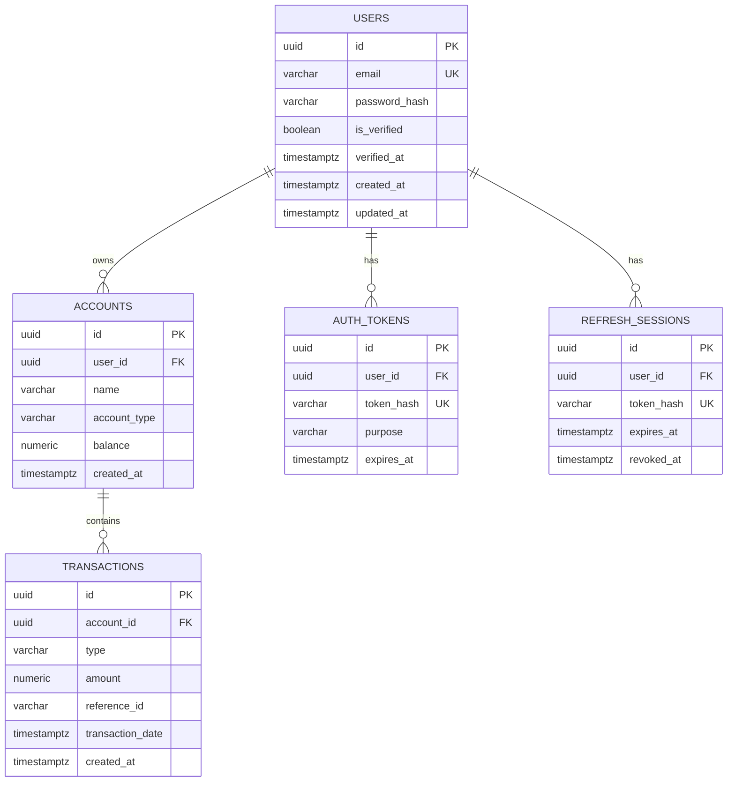

# Database Documentation

**Project:** Transaction Ledger
**Version:** 1.2
**Status:** Schema and transaction processing verified against supplied source code
**Last reviewed:** 2026-11-21

## 1. Purpose

This document records the relational database design, tables, columns, relationships, constraints, indexes, transaction behavior and migration practices used by the Transaction Ledger application.

The SQLAlchemy models describe the current application schema. Alembic migration files document its schema evolution.

## 2. Database technology

- Database engine: PostgreSQL
- ORM: SQLAlchemy
- Schema migration tool: Alembic
- Primary key format: UUID
- Monetary data type: `NUMERIC(18, 2)`
- Local database name: `transaction_ledger`
- CI database: Disposable PostgreSQL 16 service
- Production database: Hosted configuration

The backend reads `DATABASE_URL` from the environment. The database connection uses `pool_pre_ping=True`.

Local development must use the local `transaction_ledger` database through the verified local `.env`. Never use local development workflows to inspect or modify the production database.

## 3. Database tables

The application currently defines six tables:

| Table              | Purpose                                                    |
| ------------------ | ---------------------------------------------------------- |
| `users`            | Stores registered user information and verification status |
| `accounts`         | Stores financial accounts, ownership and balances          |
| `transactions`     | Stores credit and debit transactions                       |
| `auth_tokens`      | Stores hashed email-verification and password-reset tokens |
| `refresh_sessions` | Tracks refresh-token sessions and revocation               |

## 4. Table schema inventory

### 4.1 `users`

| Column          | Type                     | Nullable | Default / Constraint                          |
| --------------- | ------------------------ | -------- | --------------------------------------------- |
| `id`            | UUID                     | No       | Primary key; UUID generated by application    |
| `email`         | VARCHAR(254)             | No       | Unique; lowercase check                       |
| `password_hash` | VARCHAR(255)             | No       | —                                             |
| `is_verified`   | BOOLEAN                  | No       | Default `false`                               |
| `verified_at`   | TIMESTAMP WITH TIME ZONE | Yes      | —                                             |
| `created_at`    | TIMESTAMP WITH TIME ZONE | No       | `now()`                                       |
| `updated_at`    | TIMESTAMP WITH TIME ZONE | No       | `now()`; SQLAlchemy updates it on ORM updates |

**Constraints:**

- Primary key: `id`
- Unique constraint: `uq_users_email`
- Check constraint: `ck_users_email_lowercase`

Email values are normalized using SQLAlchemy validation and must be lowercase at the database level.

### 4.2 `accounts`

| Column         | Type                     | Nullable | Default / Constraint                       |
| -------------- | ------------------------ | -------- | ------------------------------------------ |
| `id`           | UUID                     | No       | Primary key; UUID generated by application |
| `user_id`      | UUID                     | Yes      | Foreign key to `users.id`                  |
| `name`         | VARCHAR(150)             | No       | —                                          |
| `account_type` | VARCHAR(32)              | No       | Default `savings`                          |
| `email`        | VARCHAR(254)             | Yes      | —                                          |
| `phone`        | VARCHAR(32)              | Yes      | —                                          |
| `description`  | TEXT                     | Yes      | —                                          |
| `balance`      | NUMERIC(18,2)            | No       | Default `0.00`                             |
| `created_at`   | TIMESTAMP WITH TIME ZONE | No       | `now()`                                    |

**Constraints and indexes:**

- Primary key: `id`
- Foreign key: `user_id` references `users.id`
- Foreign key deletion behavior: `RESTRICT`
- Index: `ix_accounts_user_id`

The `user_id` column is nullable. Therefore, the schema permits accounts without an associated user.

### 4.3 `transactions`

| Column             | Type                     | Nullable | Default / Constraint                       |
| ------------------ | ------------------------ | -------- | ------------------------------------------ |
| `id`               | UUID                     | No       | Primary key; UUID generated by application |
| `account_id`       | UUID                     | No       | Foreign key to `accounts.id`               |
| `type`             | VARCHAR(10)              | No       | Check: `credit` or `debit`                 |
| `amount`           | NUMERIC(18,2)            | No       | Must be greater than zero                  |
| `description`      | TEXT                     | No       | —                                          |
| `reference_id`     | VARCHAR(255)             | No       | Unique within an account                   |
| `transaction_date` | TIMESTAMP WITH TIME ZONE | No       | Supplied by application                    |
| `created_at`       | TIMESTAMP WITH TIME ZONE | No       | `now()`                                    |

**Constraints and indexes:**

- Primary key: `id`
- Foreign key: `account_id` references `accounts.id`
- Foreign key deletion behavior: `RESTRICT`
- Check constraint: `ck_transaction_type`
- Check constraint: `ck_transaction_amount_positive`
- Composite unique constraint: `uq_transaction_account_reference`
- Index: `ix_transactions_account_id`

The composite unique constraint on `(account_id, reference_id)` allows the same reference ID to exist in different accounts but prevents duplicates within the same account.

`transaction_date` represents the transaction's effective date, while `created_at` records when the database row was created.

### 4.4 `auth_tokens`

| Column       | Type                     | Nullable | Default / Constraint                            |
| ------------ | ------------------------ | -------- | ----------------------------------------------- |
| `id`         | UUID                     | No       | Primary key; UUID generated by application      |
| `user_id`    | UUID                     | No       | Foreign key to `users.id`                       |
| `token_hash` | VARCHAR(255)             | No       | Unique                                          |
| `purpose`    | VARCHAR(32)              | No       | Check: `email_verification` or `password_reset` |
| `expires_at` | TIMESTAMP WITH TIME ZONE | No       | Indexed                                         |
| `used_at`    | TIMESTAMP WITH TIME ZONE | Yes      | —                                               |
| `created_at` | TIMESTAMP WITH TIME ZONE | No       | `now()`                                         |

**Constraints and indexes:**

- Primary key: `id`
- Foreign key: `user_id` references `users.id`
- Foreign key deletion behavior: `CASCADE`
- Unique constraint: `uq_auth_tokens_token_hash`
- Check constraint: `ck_auth_tokens_purpose`
- Indexes: `ix_auth_tokens_user_id`, `ix_auth_tokens_expires_at`

### 4.5 `refresh_sessions`

| Column         | Type                     | Nullable | Default / Constraint                       |
| -------------- | ------------------------ | -------- | ------------------------------------------ |
| `id`           | UUID                     | No       | Primary key; UUID generated by application |
| `user_id`      | UUID                     | No       | Foreign key to `users.id`                  |
| `token_hash`   | VARCHAR(255)             | No       | Unique                                     |
| `expires_at`   | TIMESTAMP WITH TIME ZONE | No       | Indexed                                    |
| `revoked_at`   | TIMESTAMP WITH TIME ZONE | Yes      | —                                          |
| `created_at`   | TIMESTAMP WITH TIME ZONE | No       | `now()`                                    |
| `last_used_at` | TIMESTAMP WITH TIME ZONE | Yes      | —                                          |

**Constraints and indexes:**

- Primary key: `id`
- Foreign key: `user_id` references `users.id`
- Foreign key deletion behavior: `CASCADE`
- Unique constraint: `uq_refresh_sessions_token_hash`
- Indexes: `ix_refresh_sessions_user_id`, `ix_refresh_sessions_expires_at`

## 5. Entity relationship diagram



Note: `ACCOUNTS.user_id` is nullable. A user can have multiple accounts, but an account does not have to belong to a user.

## 6. Database relationships and deletion behavior

| Parent table | Child table        | Relationship                    | Parent deletion behavior                            |
| ------------ | ------------------ | ------------------------------- | --------------------------------------------------- |
| `users`      | `accounts`         | One-to-many, optional ownership | Restricted while accounts reference the user        |
| `users`      | `auth_tokens`      | One-to-many                     | Cascades                                            |
| `users`      | `refresh_sessions` | One-to-many                     | Cascades                                            |
| `accounts`   | `transactions`     | One-to-many                     | Restricted while transactions reference the account |

## 7. Data integrity and transaction behavior

### 7.1 Database-enforced rules

- Account and transaction relationships are enforced through foreign keys.
- Transaction amounts must be greater than zero.
- Transaction types must be `credit` or `debit`.
- Reference IDs must be unique within each account.
- User emails must be unique and lowercase.
- Authentication token hashes must be unique.
- Authentication token purposes are restricted to supported values.

### 7.2 Application-level rules

The ledger service (`app/services/ledger.py`) implements the following:

1. Retrieves the account using `SELECT ... FOR UPDATE` to acquire a row-level lock.
2. Checks whether the reference ID already exists within the specified account.
3. Rejects a debit if the available balance is insufficient, returning HTTP `422`.
4. Increases the account balance for credits.
5. Decreases the account balance for debits.
6. Creates the corresponding transaction record.
7. Commits the balance update and transaction insertion within the same database transaction.
8. Refreshes the affected ORM objects after committing.

### 7.3 Atomicity and concurrency

The account balance update and transaction insertion are committed together. If processing fails, the service rolls back the database transaction.

The account row lock serializes transaction processing for concurrent operations against the same account. This prevents competing transactions from independently spending the same previously available balance.

The lock is scoped to the account being processed; it does not globally serialize transactions across different accounts.

### 7.4 Duplicate transaction handling

Duplicate reference protection uses two mechanisms:

- Application-level lookup before transaction creation.
- Database-level unique constraint on `(account_id, reference_id)`.

If a competing request causes a database integrity error, the service rolls back and checks whether the reference already exists. If found, it returns the existing transaction and current account balance as a duplicate result.

Other integrity errors that cannot be resolved as duplicates result in HTTP `409`.

### 7.5 Important limitation

The account balance has no database check constraint requiring it to remain non-negative. The debit balance check is enforced by the ledger service.

The documented concurrency behavior is based on the service implementation using PostgreSQL row-level locking. Dedicated concurrent-request tests should continue to validate this behavior.

## 8. Migration history

Alembic manages database schema changes.

| Revision      | Date       | Description                                                                                       |
| ------------- | ---------- | ------------------------------------------------------------------------------------------------- |
| `20261104_01` | 2026-11-04 | Creates initial account and transaction tables when absent; adds account type and contact details |
| `20261108_01` | 2026-11-08 | Adds transaction date and backfills existing records using `created_at`                           |
| `20261116_01` | 2026-11-16 | Creates user, authentication-token and refresh-session tables; adds nullable account ownership    |

Migration chain:

`20261104_01` → `20261108_01` → `20261116_01`

The initial migration includes checks for existing account and transaction tables. Subsequent migrations add the required schema changes.

Migration scripts must be reviewed before execution, committed with the application changes that require them, and tested against an isolated database.

CI runs:

```bash
alembic upgrade head
```

against its disposable PostgreSQL service.

## 9. Database connection and session management

Database configuration is maintained in `app/database.py`.

- Connection URL is read from `DATABASE_URL`.
- PostgreSQL URL schemes are normalized to use the Psycopg SQLAlchemy driver.
- SQLAlchemy engine uses `pool_pre_ping=True`.
- `SessionLocal` is configured with `autoflush=False` and `expire_on_commit=False`.
- `get_db()` creates a session and closes it after the request completes.

The application raises a configuration error if `DATABASE_URL` is missing.

## 10. Environment and data safety

- Local development uses the local PostgreSQL database `transaction_ledger`.
- Local connection details must remain in the local `.env`.
- CI uses an isolated, disposable PostgreSQL 16 service.
- Production uses its hosted database configuration.
- Production credentials and connection strings must never be committed to source control.
- Local migration, reset or cleanup commands must never target the production database unintentionally.

## 11. Pending verification and future documentation

The schema and ledger service behavior have been inspected. The following areas remain to be documented:

- Test database setup and test-data practices.
- Backup and restore arrangements for production.
- Whether any production schema changes exist outside the supplied migration history.
- Operational retention and cleanup policies for expired authentication records.
- Dedicated concurrent-request test coverage for account transaction processing.

## 12. Change history

| Version | Date       | Changes                                                                                         |
| ------- | ---------- | ----------------------------------------------------------------------------------------------- |
| 1.0     | 2026-11-21 | Initial database documentation                                                                  |
| 1.1     | 2026-11-21 | Verified six tables, columns, constraints, indexes, relationships and migration history         |
| 1.2     | 2026-11-21 | Documented account locking, atomic balance updates, rollback and duplicate transaction handling |
